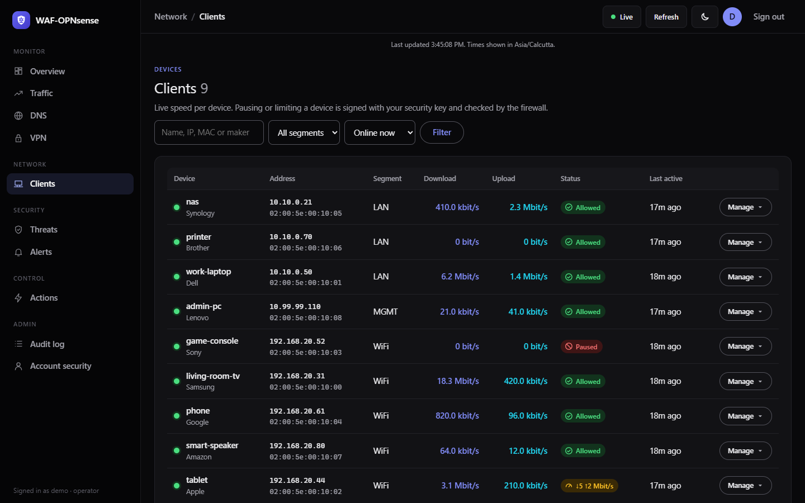
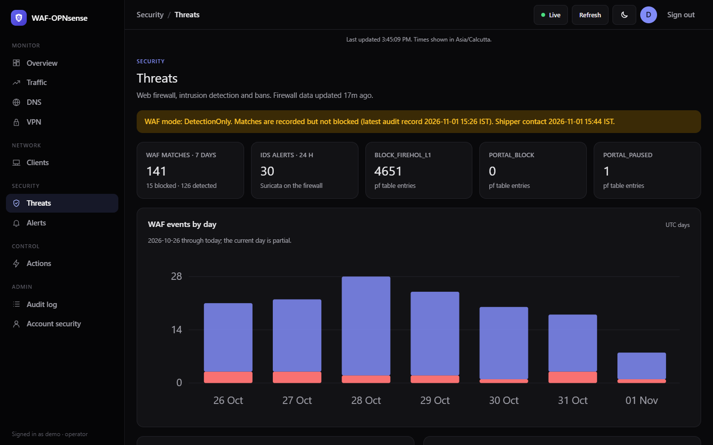
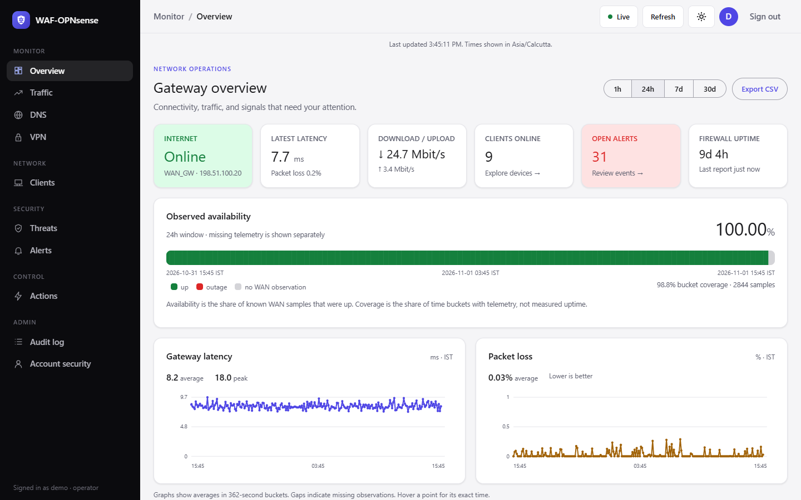

# WAF-OPNsense

A self-hosted gateway dashboard and web application security stack for a home lab. Monitor OPNsense connectivity, devices, traffic, DNS, VPNs and security events, with security-key-approved control actions.

The **WAF runs at the edge in Caddy with Coraza and OWASP Core Rule Set**. The FastAPI portal monitors it; installing the portal alone does not protect a website. The supplied edge configuration starts in **DetectionOnly**, which records matches without blocking them. The dashboard does not verify the live engine mode.


| Clients with live speeds | Threats | Light mode |
| --- | --- | --- |
|  |  |  |

Screenshots use invented devices and documentation-range addresses.

## Quick start

```sh
cp deploy/deploy.conf.example deploy/deploy.conf   # domain, box addresses, SSH key
sh deploy/deploy.sh all                             # PKI, secrets, Pi 4, Pi 5, firewall agent, host firewall, first user
```

`deploy.sh` runs from your admin PC (Linux, macOS or Git Bash) over SSH and every step can be run again on its own
(`check`, `pki`, `secrets`, `services`, `edge`, `firewall`, `hostfw`, `user`, `keys`, `status`). It never overwrites
existing secrets, the firewall's `agent.json` or the portal database, adopts the `.env` files of a box that is already set
up, and refuses to replace a box's certificates with different ones. The [runbook](docs/RUNBOOK.md) explains each step.

## Dashboard

- Navigation grouped into Monitor, Network, Security, Control and Admin; clean zinc/black theme with light, dark and system modes.
- Times shown in your browser's own time zone (PORTAL_TZ is the fallback).
- Latency, packet loss, bandwidth and availability graphs with timestamp tooltips; 1-hour, 24-hour, 7-day and 30-day windows.
- Per-device download and upload speed, status badges (allowed, paused, limited, pending) and a Manage menu to pause, resume or speed-limit a device. Each change is signed with your security key and checked by the firewall.
- Average latency/loss, peak throughput, observed availability and telemetry coverage. Missing observations leave gaps rather than suggesting healthy service.
- Timestamped network flow snapshot, current clients, recent alerts and outage history.
- Device search by name, IP, MAC or maker; segment/status filters. Alerts filter by search, source and severity.
- Threats: recent WAF events with rule, client and path, top rules/clients/paths, per-site totals, Suricata sources and signatures, and active CrowdSec bans. Ordinary HTTP 403 responses are not counted as WAF blocks.
- Authenticated JSON metrics and CSV downloads, bounded to 240 aggregate points per window.
- Live content updates, pause/resume, manual refresh, timeout/error feedback and a responsive layout with a drawer menu on phones. No CDN dependencies.

## Security and scope

Passkeys/FIDO2 or password plus TOTP, recovery codes, CSRF protection, trusted-proxy IP handling and viewer/operator roles protect the portal. The OPNsense agent pushes telemetry over mutual TLS and independently checks operator signatures before allowlisted actions. Start read-only, then provision trusted operator keys manually.

This is a home-lab project, not a security certification. WAF inspection covers HTTP traffic routed through the edge. OPNsense firewall rules, segmentation, CrowdSec and Suricata have separate jobs. See [security and limitations](docs/SECURITY.md).

## Local development

Use Python 3.12+, OpenSSL on PATH, and Node.js for the JavaScript syntax check. Development mode is for localhost only.

PowerShell, from this repository:

```powershell
py -3.12 -m venv portal/.venv
./portal/.venv/Scripts/python.exe -m pip install -r portal/requirements.txt pytest httpx
cd portal
$env:PORTAL_DEV = '1'
./.venv/Scripts/python.exe -m app.cli gen-key
./.venv/Scripts/python.exe -m app.cli create-user admin --role operator
./.venv/Scripts/python.exe -m uvicorn app.main:app --host 127.0.0.1 --port 8000 --no-proxy-headers
```

Linux/macOS:

```bash
python3 -m venv portal/.venv
portal/.venv/bin/python -m pip install -r portal/requirements.txt pytest httpx
cd portal
export PORTAL_DEV=1
.venv/bin/python -m app.cli gen-key
.venv/bin/python -m app.cli create-user admin --role operator
.venv/bin/python -m uvicorn app.main:app --host 127.0.0.1 --port 8000 --no-proxy-headers
```

Open http://localhost:8000 and sign in with the TOTP setup printed by create-user. Empty graphs are expected until the agent reports; this project does not substitute demo data for live telemetry.

## Where the WAF is configured

WAF policy lives on the edge, not in the portal: the portal only shows what the WAF did, so a compromised portal cannot weaken it.

- **Rules:** the `(waf)` snippet in [deploy/edge/caddy/Caddyfile](deploy/edge/caddy/Caddyfile) loads the OWASP Core Rule Set through Coraza. Add exclusions inside its `directives` block, for example `SecRuleRemoveById 911100` or a narrower `SecRuleUpdateTargetById`.
- **Mode:** `WAF_MODE` in `deploy/edge/.env` (`DetectionOnly` records, `On` blocks). Give one site its own copy of the snippet with `SecRuleEngine On` to switch sites one at a time.
- **Apply:** `sh deploy/deploy.sh edge` (or `docker compose up -d` in `deploy/edge` on the Pi 5).

Check the Threats page for false positives before switching to `On`. For example, rule 911100 ("Method is not allowed by policy") fires on PUT requests that apps such as password vaults use, so it needs an exclusion for those sites first.

## Deployment and configuration

`deploy/deploy.sh` does the whole two-host deployment (see Quick start); [the runbook](docs/RUNBOOK.md) covers the same steps by hand. Keep `.env`, `deploy/deploy.conf`, certificates, private keys and databases out of Git.

| Component | Location | Purpose |
| --- | --- | --- |
| FastAPI portal | `portal/` | Dashboards, authentication, signed actions |
| OPNsense agent | `agent/` | Telemetry collection and verified actions |
| Caddy, Coraza/CRS, CrowdSec | `deploy/edge/` | Edge HTTP inspection and bans |
| Portal, mTLS ingest, CrowdSec LAPI | `deploy/services/` | Services host |
| PKI and host firewall | `deploy/pki/`, `deploy/hostfw/` | Private TLS and interim network isolation |

Current defaults use Cloudflare-proxied DNS, WAN IPv4 port forwarding to Caddy on 80/443, portal HTTPS on **9443**, agent mTLS on **9444**, and CrowdSec LAPI on **9080**. Cloudflare Tunnel is not deployed by these Compose files.

Important settings include PORTAL_ORIGIN, PORTAL_RP_ID, PORTAL_COOKIE_DOMAIN, PORTAL_TRUSTED_PROXIES, PORTAL_RETENTION_DAYS (90 by default), PORTAL_TZ, PORTAL_WAF_SHIP_TOKEN, CROWDSEC_PORTAL_KEY (read-only bouncer key for the bans list) and optional Telegram credentials. Compose supplies the production origin/proxy settings. Agent interface names and gateway names must match your firewall.

## Validation and contributing

From the repository root on Windows:

```powershell
./portal/.venv/Scripts/python.exe -m pytest -q portal/tests
node --check portal/app/static/portal.js
```

On Linux use `portal/.venv/bin/python` instead. OpenSSL must be available for the real ES256/Ed25519 agent signature tests. Tests use temporary databases and software authenticators, without changing a firewall. See [the review](REVIEW.md) for validation boundaries and remaining work. For contributions, include a clear problem statement and focused tests; never include personal telemetry or credentials.

[Metrics reference](docs/METRICS.md) · [Community post draft](docs/COMMUNITY_POST.md) · [Historical design plan](Firewall%20Gateway%20Portal%20and%20WAF%20%E2%80%93%20Plan.md)
