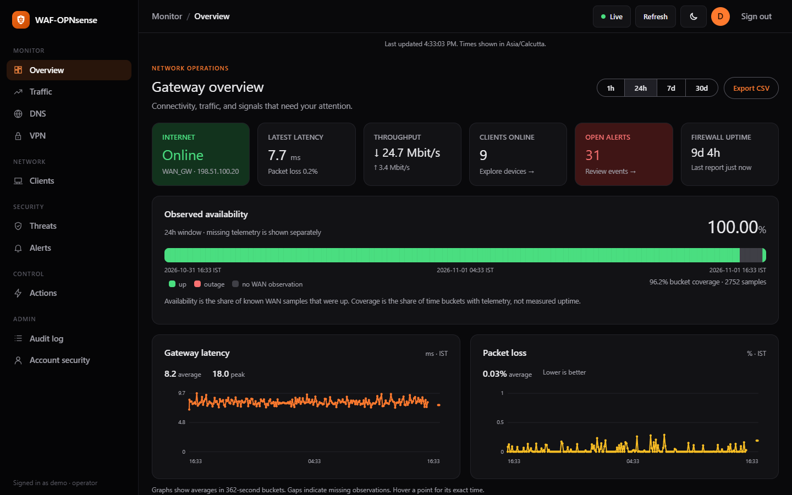

# OPNGate

Your OPNsense gateway, in one console. Monitor networks, devices, live traffic and security events, and approve network changes with a security key.

OPNsense handles routing, firewalling, DNS and VPNs. OPNGate provides the management interface and telemetry service. Caddy/Coraza supplies a separate web application firewall for published websites.

Previously **WAF-OPNsense**. Source: [jahmed-cloud/OPNGate](https://github.com/jahmed-cloud/OPNGate). This is an independent home-lab project.



The screenshots show an earlier release under the previous name, with invented devices and sample addresses. The OPNGate rebuild keeps the sidebar layout and orange theme.

## Start deployment

On Windows, clone or download this repository, then **double-click `Deploy.cmd`**. The guided launcher offers Configure, Check, Install, Update and Status. First launch collects the deployment settings and saves them in an ignored private file.

```powershell
git clone https://github.com/jahmed-cloud/OPNGate.git
cd OPNGate
.\Deploy.ps1
```

Prepare root SSH key access and verified host fingerprints, Docker Compose on the two Linux hosts, a proxied DNS record, and the required firewall port forwards. The default console hostname for a new setup is `opngate.<your-domain>`.

On Linux, macOS or Git Bash:

```sh
cp deploy/deploy.conf.example deploy/deploy.conf
# Edit domain, host addresses, SSH key, interfaces and admin access.
sh deploy/deploy.sh check
sh deploy/deploy.sh all
```

For an existing installation, use **Update** in the launcher or `sh deploy/deploy.sh update`. It updates the portal, ingest service and matching WAF shipper while retaining live routes, host firewall policy, certificates, agent configuration and operator trust. A hostname migration is a separate operation.

Read [installation](docs/INSTALL.md), [the runbook](docs/RUNBOOK.md) and [hostname migration](docs/HOSTNAME_MIGRATION.md) before deploying. Real settings, certificates, databases and private keys stay out of Git.

## The console

- **Overview:** Internet state, latency, packet loss, availability, current throughput, alerts and expandable network flow.
- **Networks:** current interface rates, device counts, device links and per-network website controls without historical queries.
- **Devices:** live download/upload, names and type icons, search and filters, plus pause, speed limit and website policies.
- **Traffic:** a rolling three-minute live WAN graph, timestamped history, per-network rates and CSV export.
- **Security:** Suricata alerts, background CrowdSec information with freshness, WAF events and audit history.
- **DNS and VPN:** resolver information and WireGuard peers.
- **Help & guides:** in-console instructions for device pause, website/network policies, external IP blocks, approval, status and undo.
- **Access:** passkeys/security keys or password plus TOTP, recovery codes and viewer/operator roles.
- **Signed controls:** operator-approved requests are independently checked by the OPNsense agent. New installations start with actions disabled.

Live rates use authenticated server-sent events at a nominal one-second interval, with automatic reconnect and a one-second JSON fallback. The latest shared frame lives in a bounded RAM volume. Device metadata refreshes every 30 seconds; historical charts every 60 seconds. Values and chart paths update in place, with time labels and explicit gaps when observations are missing.

Rates cover traffic observed by the firewall. Traffic switched entirely within a subnet is outside that view. Collection and delivery delays vary; a one-second interval is approximate.

## Components

| Component | Location | Responsibility |
| --- | --- | --- |
| Console workspaces | `portal/app/console/` | Overview, networks, devices, traffic, protection and APIs |
| Browser workspaces | `portal/app/static/console/` | Live transport, charts, DOM updates, credentials and controls |
| Access and actions | `portal/app/` | Sessions, MFA, signed actions and audit |
| Firewall agent | `agent/` | Telemetry over mTLS and verified action execution |
| Services stack | `deploy/services/` | Portal HTTPS 9443, ingest mTLS 9444, CrowdSec LAPI 9080 |
| Edge stack | `deploy/edge/` | Caddy on 80/443, Coraza/OWASP CRS, CrowdSec and WAF reporting |
| Deployment launcher | `Deploy.cmd`, `Deploy.ps1`, `deploy/deploy.sh` | Guided configuration and scoped deployment |

The rebuild separates application workspaces while retaining the established authentication, telemetry and action protocols. Existing databases and route URLs remain supported. See [architecture and feature parity](docs/ARCHITECTURE.md).

## Web application firewall

Policy belongs to the edge, rather than the management dashboard. New deployments start in **DetectionOnly**, recording matches for tuning. Set `WAF_MODE=On` in the private edge environment after reviewing legitimate traffic and running application checks.

The supplied Caddy policy permits Vaultwarden REST methods only on its `/api/` paths. Other sites retain the default method restrictions; all request payloads remain inspected. Confirmed Coraza interruptions establish WAF blocks; an ordinary HTTP 403 or shipper heartbeat alone does not.

For an existing edge, validate Caddy and recreate only its service after a policy change:

```sh
cd /opt/gateway/deploy/edge
docker compose config -q
docker exec gw-edge-caddy-1 caddy validate --config /etc/caddy/Caddyfile --adapter caddyfile
docker compose up -d --no-deps caddy
```

Test normal login, APIs, uploads and WebSockets, then a harmless known-rule probe on a site you own. See [security limitations](docs/SECURITY.md) and [WAF operations](docs/WAF.md).

## Development and validation

Python 3.12+, OpenSSL and Node.js are required for the full checks. On Windows:

```powershell
py -3.12 -m venv portal/.venv
./portal/.venv/Scripts/python.exe -m pip install -r portal/requirements.txt pytest httpx
./portal/.venv/Scripts/python.exe -m pytest -q portal/tests deploy/tests
node --check portal/app/static/portal.js
node portal/tests/test_refresh_dom.cjs
node portal/tests/test_live_stream.cjs
```

For local development, set `PORTAL_DEV=1`, generate the local encryption key with `python -m app.cli gen-key`, create a user with `python -m app.cli create-user admin --role operator`, and start `uvicorn app.main:app --host 127.0.0.1 --port 8000 --no-proxy-headers` from `portal/`. Development mode is for localhost.

[Metrics](docs/METRICS.md) · [Live stream](docs/LIVE_STREAM.md) · [Performance](docs/PERFORMANCE.md) · [Project status](docs/STATUS.md) · [Blocking guide](docs/BLOCKING.md) · [Review](REVIEW.md) · [Community announcement](docs/COMMUNITY_POST.md)
